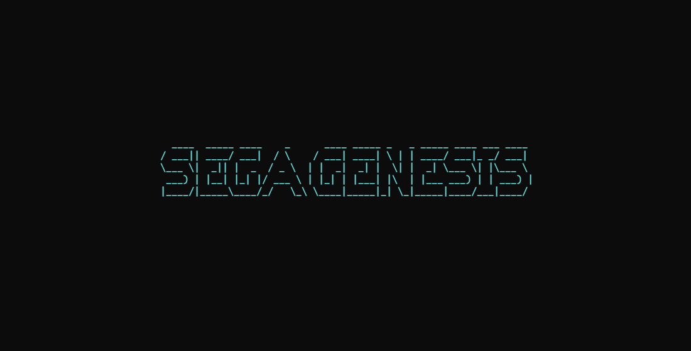
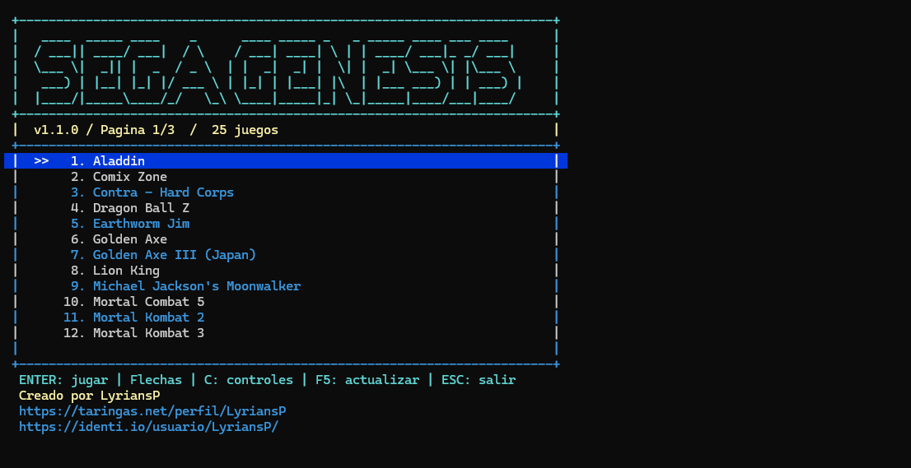
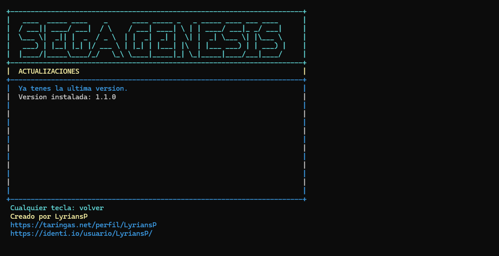
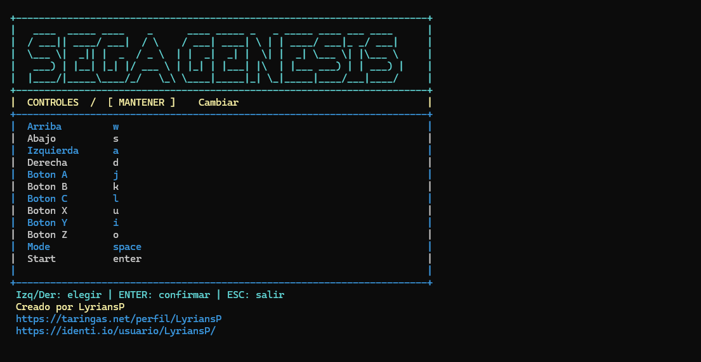

# Sega Launcher

Un launcher de Sega Genesis con una biblioteca para navegar con el teclado.

**Creado por LyriansP.**

## Descargar

Descargá **SegaLauncher-Instalador.exe** desde [la última versión](https://github.com/Lyrians/segalauncher/releases/latest).

Ejecutá el instalador y abrí Sega Launcher desde Inicio o desde el acceso directo del escritorio. En el primer inicio podés mantener o cambiar los controles.

## Controles del menú

- **Arriba / abajo:** elegir un juego.
- **Izquierda / derecha:** cambiar de página.
- **Enter:** abrir el juego.
- **C:** configurar los controles.
- **F5:** buscar actualizaciones.
- **Esc:** volver al menú desde el juego o cerrar el launcher desde la biblioteca.

## Actualizaciones

Desde la versión 1.1.0, presioná **F5** en la biblioteca para buscar una versión nueva. Si hay una disponible, podés descargarla e iniciar su instalación. El instalador conserva los controles, las partidas y los juegos existentes.

Si tenés la primera versión, instalá la versión nueva sobre la anterior, sin desinstalarla.

Este repositorio se utiliza para publicar las descargas y la información del programa. El código de desarrollo se mantiene por separado.

## Capturas

### Inicio

### Biblioteca de juegos

### Actualizaciones

### Configuración de controles

